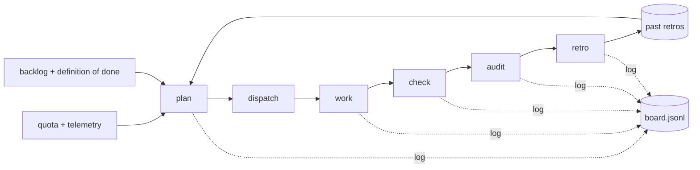

# agent-skills
Small, plain agent skills. Each is a folder with a `SKILL.md`, the open Agent Skills format, so it works in Claude (Claude Code and the Claude apps), OpenAI Codex, and other tools that read that format.

## Skills
| Skill | What it does |
|---|---|
| [`quota-burn`](quota-burn/SKILL.md) | Turns spare AI quota into useful, checked work, and gets better each cycle. You give it the quota, a plain-language backlog and a place to log. It dispatches workers, checks every task against a definition of done, has an independent auditor spot-check, writes a short retro, and uses past retros to plan the next cycle. Everything is logged to one JSONL board in git (or a Slack thread). |

### How quota-burn works

## Install
- **Claude Code:** copy the folder into `~/.claude/skills/`.
- **Codex:** copy it into `~/.codex/skills/`.
- **Claude apps:** add the zipped folder as a skill in your Claude settings.

Then say "burn my quota" or "use quota-burn".
